# Lucid

**A small chat app built to show the whole life of an LLM request — nothing hidden behind a framework.**

Lucid is a single-user chat application: you type, a model answers, the answer streams in, and everything is stored in PostgreSQL. The point is not the chat window. It is everything around the model call: building the context, streaming the answer, cancelling it, retrying after a failure, switching models, and measuring what happened — written and tested by hand.

It is also a worked example of **spec-driven development**: the specification came first, the consequential choices were written down as ADRs, the build followed a plan with exit criteria, and the acceptance results were recorded instead of claimed.

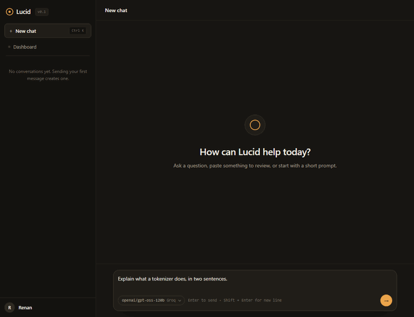

---

## What it does

- **Chat with streaming replies.** Server-Sent Events, ~0.4 s to the first token on Groq.
- **Choose the model per message.** Groq, Gemini, or the offline scripted provider — from one picker.
- **Stop, retry, and recover.** Partial text survives a stop; a failed message keeps its text and gets a Retry button.
- **Remember everything.** Conversations, messages and every generation attempt, with token usage and timing.
- **Read the telemetry.** A dashboard with volume, success rate, tokens, latency percentiles and a details dialog per attempt.

## The application

| Conversation, two models | Model picker |
| --- | --- |
| 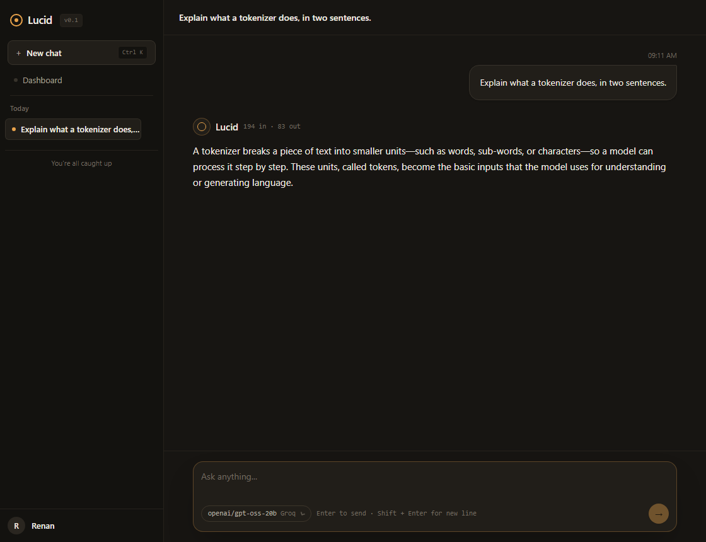 | 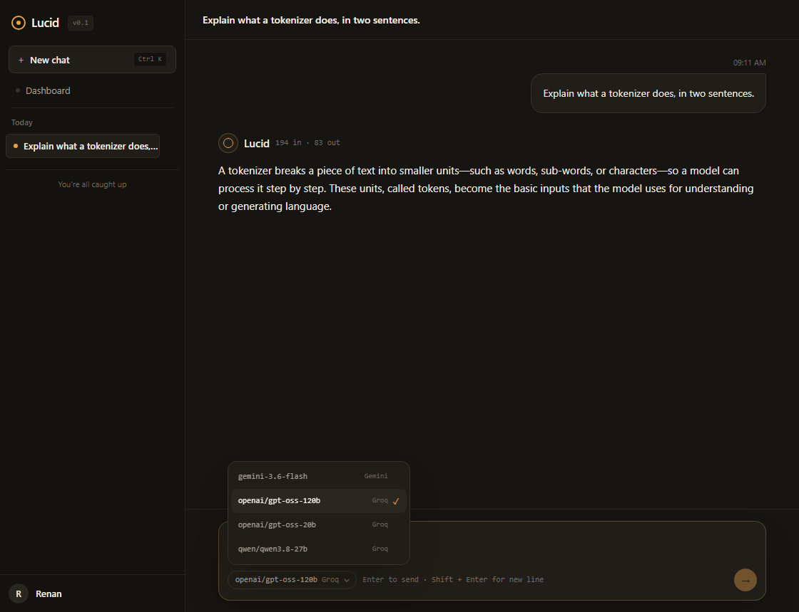 |
| The first turn ran on `gpt-oss-120b`, the second on `gpt-oss-20b`. Usage is per response; history is shared. | The picker lists only models the server is configured for, and remembers your choice across reloads. |

| Dashboard | Interrupted generation |
| --- | --- |
| 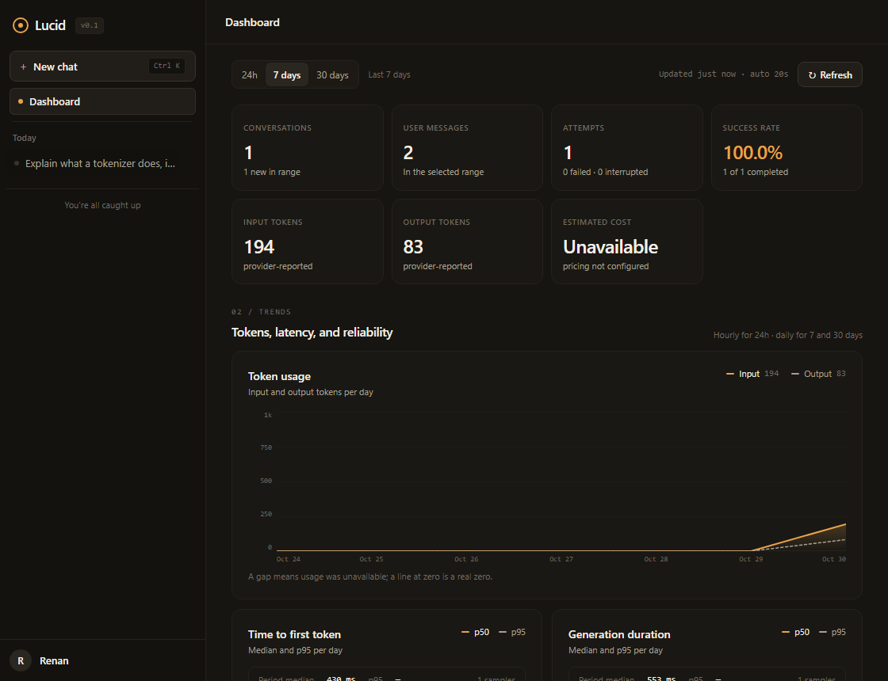 | 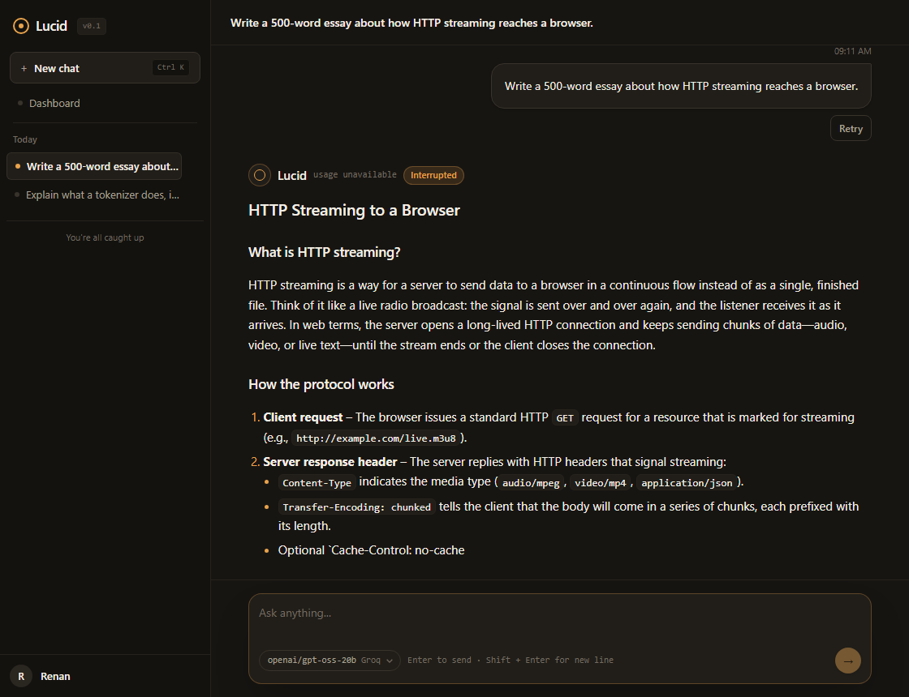 |
| Volume, success rate, tokens, p50/p95 latency and recent attempts — all from the database, not from a log scraper. | Stop keeps what was already received and marks the attempt `interrupted`. Retry reuses the original message. |

| Generation details | On a phone |
| --- | --- |
| 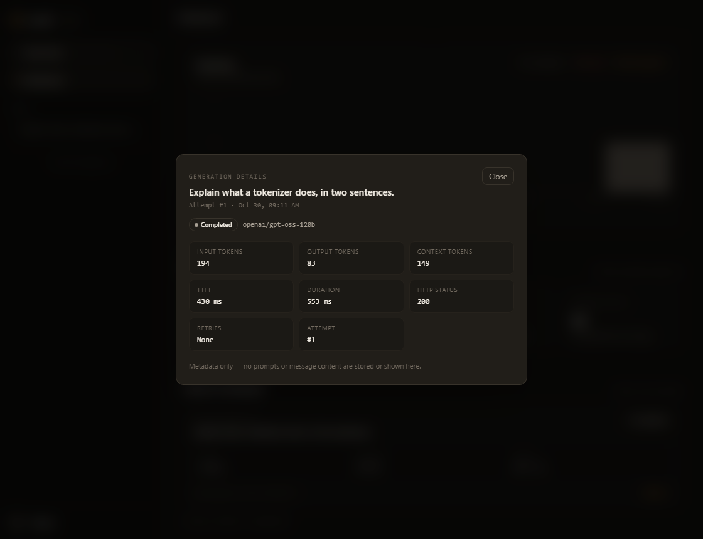 | 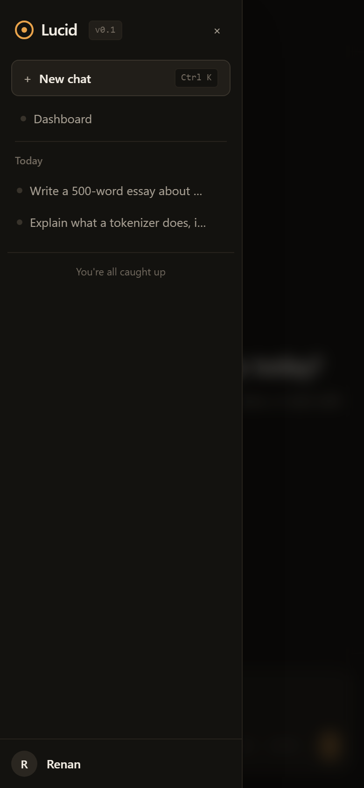 |
| One attempt: model, status, tokens, timing, error code. This is how a mixed-model conversation stays honest. | The same components, a drawer instead of the sidebar. |

---

## What happens when you press Enter

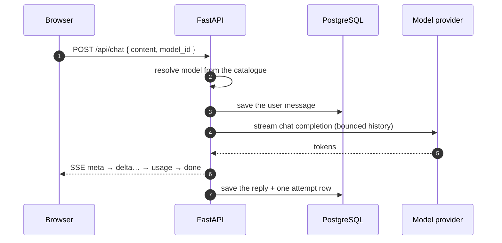

The browser never talks to a provider, and never sees a key. The reply is committed **before** the terminal `done` event is sent, so a client that reacts to `done` can re-read the conversation and find the message already there.

Every message becomes one **attempt** row: model, provider, status, token usage, first-token time, HTTP status, error code. That single table is why the dashboard can be honest and why a conversation can mix models without lying about it.

## One provider boundary, three implementations

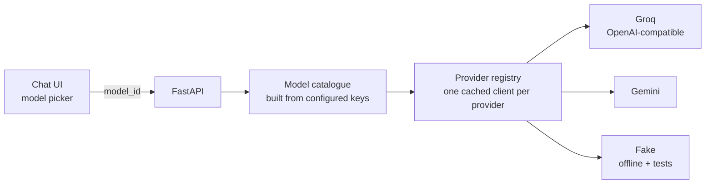

The application owns a narrow `ChatProvider` protocol:

```python
class ChatProvider(Protocol):
    name: str
    def stream(self, request: GenerationRequest) -> AsyncIterator[ProviderEvent]: ...
```

No SDK type crosses that line. The default adapter speaks the OpenAI chat-completions wire format over `httpx`, so **Groq, Cerebras, OpenRouter, Mistral and Ollama are a base URL apart** — the choice is configuration, not code. Gemini keeps its own adapter behind the same protocol.

The picker is built from what is actually configured: a provider with no key is not offered, so a model choice cannot fail on first use. `GET /api/models` returns the list and a default; `POST /api/chat` accepts `model_id` and rejects an unknown one with `400` before anything is stored.

## When things go wrong

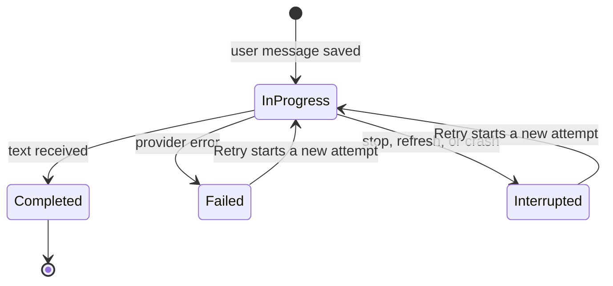

- **Rate limits** carry the provider's own wait hint; the UI shows the reset time and disables Retry until then. A short in-process cooldown stops the app from hammering a provider that just said *no*.
- **Transient errors** get at most two automatic retries with jittered backoff — and only before the first token, because retrying after text has streamed would duplicate output.
- **Stop** cancels the asyncio task driving the provider stream and persists what arrived as `interrupted`.
- **Crash** recovery runs at startup: attempts stranded `in_progress` by a restart are closed as `interrupted` with `error_code = process_restart`.

## Built spec-first

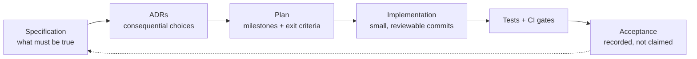

The specification (`docs/specs/`) states requirements and acceptance criteria. Before building, the choices that would be expensive to reverse became ADRs (`docs/decisions/`) — provider, data model, streaming, identifiers, failure semantics, frontend, and later the second provider and model picker. The plan (`docs/plans/`) turned those into milestones with exit criteria.

The process was not decoration. Re-reading the provider docs changed the default model twice; measuring latency moved it again; a 20-request-per-day free tier forced the second provider; the code-health budget forced a 585-line module to be split before the dashboard was built. Those turns are recorded, with the evidence, in **[How this was built](docs/how-it-was-built.md)**.

## Tested, and gated

| Layer | What it proves | Count |
| --- | --- | --- |
| Backend unit | context budgeting, retry policy, error mapping, titles, cursors | part of 258 |
| Backend integration | real PostgreSQL, migrations, SSE frames, stop/disconnect, reconciliation, dashboard queries | part of 258 |
| Frontend | SSE parsing, Markdown sanitization, streaming UI, model picker, dashboard charts | 125 tests, 26 files |
| Browser E2E | send → stream → reload → delete, against the built app | Playwright, opt-in |
| Live (opt-in) | a real provider stream and first-token latency | 1 file, skipped by default |

- **258 backend tests** pass with no network; the full suite runs in ~30 s against PostgreSQL.
- **89.6 % backend coverage** and **~91 % frontend line coverage**, enforced in CI.
- **Strict types everywhere:** Pyright strict on the backend, TypeScript strict on the frontend. Zero errors, zero suppressions in the application code.
- **Budgets, not opinions:** files ≤ 300 lines (350 for providers), functions ≤ 50 lines, cyclomatic complexity ≤ 12, ≤ 5 parameters, ≤ 4 nesting levels, enforced by a test that parses the source.
- **One import boundary test** proves the domain layer never imports the provider adapters.

Details and commands: **[Testing](docs/testing.md)** and **[Code quality](docs/code-quality.md)**.

## Run it

```powershell
npm install
Copy-Item .env.example .env    # paste OPENAI_API_KEY (Groq) or GEMINI_API_KEY
npm run dev                    # PostgreSQL, migrations, API :8000, web :5173
```

No key? Set `PROVIDER=fake` and the app runs on a scripted provider — the same code path, no network, no quota.

## Documentation

Start here, then pick the branch you care about.

- **[Documentation index](docs/README.md)** — what each document is, and which are historical records
- **[Architecture](docs/architecture.md)** — request lifecycle, data model, provider boundary, failure semantics
- **[Testing](docs/testing.md)** — the pyramid, what each layer proves, how to run it
- **[Code quality](docs/code-quality.md)** — the gates, the budgets, and the refactors they forced
- **[How this was built](docs/how-it-was-built.md)** — spec → ADR → plan → acceptance, and what changed along the way
- **[ADRs](docs/decisions/)** — the decisions themselves, with alternatives and costs
- **[Specification](docs/specs/001-lucid-specification.md)** — requirements, non-goals, acceptance criteria
- **[Screen mockups](docs/screen-mockups/)** — the static design pass that preceded the components

The GIF and screenshots are generated from the running app, not hand-made:

```powershell
npm run dev
npm run demo:media          # docs/demo.gif + docs/images/*.webp
```

## Limits

- Single user, no authentication. Do not expose it beyond localhost.
- One backend process: cancellation tracking is in memory. Multiple workers would need the DB-backed design noted in ADR-003.
- Free-tier quotas are the real ceiling. Groq gives 1,000 requests/day and 8K tokens/minute; Gemini gives 20 requests/day. The context budget (6K input tokens) is sized for the tighter of the two.
- Partial text is only persisted at the end of an attempt, so a hard crash loses the tail of the current reply.
- The rate-limit cooldown is per process, not per model, so a 429 on one model briefly blocks the others.

## License

MIT.
