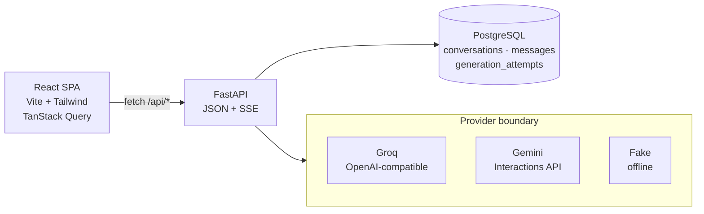
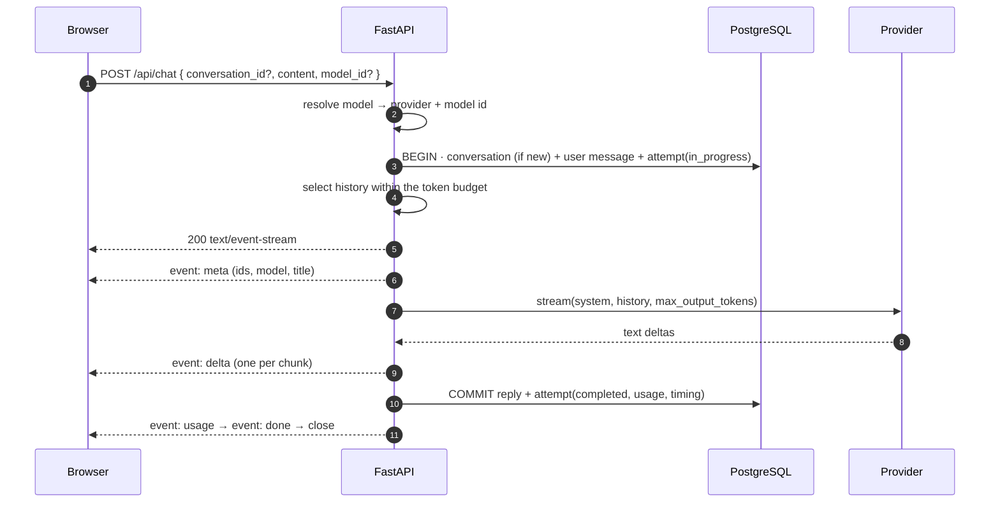
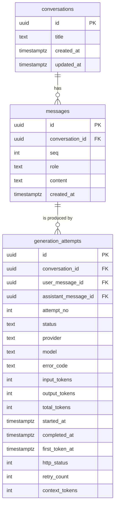
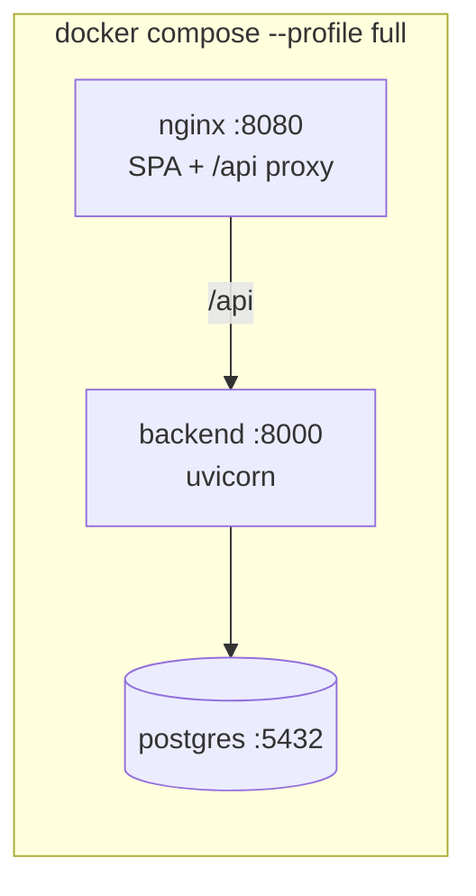

# Architecture

Lucid is one FastAPI process, one React app, and one PostgreSQL database. The interesting parts are the boundaries inside that process: where the provider ends, where persistence begins, and what happens when a stream dies halfway.



## 1. The layers

| Layer | Directory | Owns |
| --- | --- | --- |
| API | `backend/src/lucid/api/` | HTTP routes, request/response schemas, SSE framing, dependency wiring |
| Application | `application/` | conversation orchestration, context budgeting, attempt lifecycle, dashboard queries |
| Domain | `domain/` | provider protocol and events, error taxonomy, enums, identifiers |
| Persistence | `persistence/` | SQLAlchemy tables, repositories, migrations |
| Providers | `providers/` | OpenAI-compatible adapter, Gemini adapter, fake provider, factory |
| Frontend | `frontend/src/` | pages, components, hooks, API client, Markdown rendering |

The dependency direction is enforced by a test: `domain` imports nothing from `providers` or `persistence`, and `persistence` imports nothing from `providers`. Only the application layer talks to a provider, and only through the protocol.

## 2. One message, end to end



Ordering matters in two places:

1. **The user message is written before the provider is called.** A crash or a provider failure can never lose it, and retry always has a message to target.
2. **The reply is committed before `done` is emitted.** A client that reacts to `done` by re-reading the conversation finds the message already there, instead of racing the write.

## 3. Data model

Three tables. The assistant's text lives on `messages`, and `generation_attempts` records what happened while producing it.



Rules that the database, not the caller, enforces:

- **One `in_progress` attempt per conversation**, via a partial unique index. Two concurrent sends to the same conversation cannot both proceed; the second gets `409 generation_in_progress`.
- **One `attempt_no` per user message.** A retry increments it, so history keeps every try.
- **Canonical assistant text on `messages.content`** (ADR-002). The attempt holds lifecycle and usage; it is not a second copy of the text.
- **UUIDv7 primary keys** (ADR-004), so ids sort by creation time and index locality is good.
- **Keyset pagination** on `(updated_at DESC, id DESC)` with an opaque cursor — no offsets, no duplicate rows when a conversation is bumped between pages.

## 4. The streaming contract

`POST /api/chat` and the retry endpoint return `text/event-stream`. Each frame is one named event with a single JSON line.

| Event | When | Payload |
| --- | --- | --- |
| `meta` | once, first | `conversation_id`, `conversation_title`, `user_message_id`, `attempt_id`, `model`, `is_new_conversation` |
| `delta` | zero or more | `text` |
| `usage` | when reported | `input_tokens`, `output_tokens`, `thought_tokens`, `total_tokens` |
| `done` | terminal | `attempt_id`, `status`, `assistant_message_id`, `finish_reason` |
| `error` | terminal | `code`, `message`, `retryable`, `retry_after_seconds?`, `attempt_id` |

Guarantees:

- Exactly one terminal event (`done` or `error`), then the connection closes.
- Errors detected **before** the stream starts are normal JSON errors with the shared envelope `{"error": {"code", "message", "details"}}` — 400/404/409/422.
- Headers disable buffering: `Cache-Control: no-cache`, `X-Accel-Buffering: no`, `Connection: keep-alive`. nginx in the Compose stack is configured to pass SSE through.
- The client parses frames with `fetch` + `ReadableStream`, not `EventSource`, because `EventSource` cannot send a POST body (ADR-003).

## 5. Cancellation

An in-process registry maps `attempt_id → asyncio.Task`.

- **Stop** cancels the task, which closes the provider stream, and finalizes the attempt as `interrupted`.
- **Disconnect or refresh** surfaces as `CancelledError` inside the streaming generator; the same finalization runs.
- Finalization is shielded so it is not itself cancelled mid-write.
- If the process died, **startup reconciliation** closes orphaned `in_progress` attempts as `interrupted` / `process_restart`.

The registry being in memory is a deliberate MVP limit: it keeps Stop instant and the code small, at the cost of only working with one worker process. ADR-003 records the DB-backed alternative.

## 6. Provider boundary

```python
class ChatProvider(Protocol):
    name: str
    def stream(self, request: GenerationRequest) -> AsyncIterator[ProviderEvent]: ...
```

`GenerationRequest` carries the model, system prompt, bounded history and output cap — all application-owned types. The events are `TextDelta` and `StreamCompleted(usage)`. SDK exceptions never escape an adapter; they become the domain errors in §7.

Three implementations:

| Provider | Transport | Notes |
| --- | --- | --- |
| `openai_compatible` (default) | `httpx` + SSE, no vendor SDK | Groq out of the box; same code for Cerebras, OpenRouter, Mistral, Ollama by base URL |
| `gemini` | `google-genai`, Interactions API | Second implementation that proved the boundary; kept for quota diversity |
| `fake` | in-process | Deterministic text for tests and offline demos |

**The catalogue** (`GET /api/models`) is built at startup from configured keys: Gemini when `GEMINI_API_KEY` is present, each entry of `OPENAI_MODELS` when an OpenAI-compatible key is present, and the scripted provider when neither is. Ids are namespaced (`openai:<model>`, `gemini:<model>`), the default comes from `PROVIDER`, and the picker never offers a model that would fail immediately.

The **registry** builds one client per provider lazily and closes them on shutdown.

## 7. Failure semantics

Every failure becomes one of a small set of domain errors, each with a stable code and a `retryable` flag:

| Code | Meaning | Auto-retried |
| --- | --- | --- |
| `provider_rate_limited` | 429 or quota exhaustion; carries the provider's wait hint | yes, until the first token |
| `provider_timeout` | request or first-token timeout | yes |
| `provider_unavailable` | 5xx, connection reset, `gateway_timeout` | yes |
| `provider_invalid_request` | 4xx from the provider | no |
| `provider_safety_blocked` | refusal / safety stop | no |
| `provider_stream_error` | malformed or aborted stream | no |
| `empty_response` | finished without text | yes |
| `context_too_large` | history + prompt cannot fit | no |

Retry policy: at most **2 automatic retries**, exponential backoff from 1 s to 8 s with jitter, and **never after the first text token** — after that the user gets a manual Retry so partial output is not duplicated.

A provider 429 also starts a short **cooldown** shared by the process, so the next request fails fast with the remaining wait instead of hitting the provider again.

## 8. Context budget

The full conversation is stored; only a slice is sent.

- Default input budget: **6,000 tokens** for system prompt + history.
- Reserve for the reply: **2,048 tokens**; safety margin: **512**.
- Hard cap of **60 messages** regardless of budget.
- Selection walks backwards from the newest message and always includes the newest user message.
- If the system prompt plus the newest message cannot fit, the request fails with `context_too_large` rather than silently truncating.

Numbers used for selection are local estimates and are never presented as provider truth; provider-reported usage is what gets stored and displayed.

## 9. Dashboard and telemetry

The dashboard reads one endpoint, `GET /api/dashboard?range=24h|7d|30d`, and renders what it returns. The browser does no aggregation.

- Day buckets are pinned to UTC, so a chart cannot disagree with itself across time zones.
- Percentiles are computed in SQL, per bucket, from `first_token_at` and `completed_at`.
- Pricing is configuration (`PRICING_*`); with no rates, cost is shown as *unavailable* rather than invented.
- Telemetry retention (`TELEMETRY_RETENTION_DAYS`, default 30) deletes old **attempts** only. Conversations and messages are never deleted by cleanup.

## 10. Deployment shape

Local and CI run the same three pieces:



- The backend image runs `alembic upgrade head` before serving.
- The frontend is built once and served as static files.
- `npm run dev` runs PostgreSQL in Docker but the API and web app on the host, with hot reload.

## 11. Known gaps

- One worker. Cancellation, cooldowns and the registry are per process.
- No auth, no multi-user isolation, no rate limiting in front of the app.
- Partial text is written only at the end of an attempt; a hard crash loses the tail.
- No conversation summarization; long conversations lose their oldest turns from the model's view.
- The cooldown is per process, not per model, so one 429 briefly blocks every model.

These are recorded as decisions, not accidents: see [ADR-003](decisions/ADR-003-provider-boundary-streaming-cancellation.md) and [ADR-007](decisions/ADR-007-openai-compatible-provider-and-model-selection.md).
