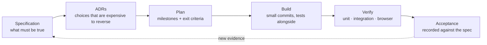

# How this was built

Lucid was built in the order a real project would be: a specification first, decisions written down before code, a plan with exit criteria, and acceptance recorded at the end. This page is the honest history — including the parts where the plan changed because reality disagreed with it.

## The loop

Three rules made the loop useful:

1. **Write the requirement before the code.** Every feature in the spec has an acceptance criterion, and the criterion is a sentence a person can check.
2. **Record the choice, not just the result.** Each ADR keeps the alternatives that were rejected and what they would have cost. That is the part that is normally lost.
3. **Let evidence reopen decisions.** Two decisions were reversed by measurements, and both reversals are recorded as amendments in place, not quietly rewritten.

## Timeline

| Date | What happened | Where it is recorded |
| --- | --- | --- |
| 2026-10-28 | Requirements interview; scope, non-goals and acceptance criteria fixed | [spec v0.2](specs/001-lucid-specification.md) |
| 2026-10-28 | Provider, data model, streaming, identifiers, failure semantics, frontend decided | [ADR-001](decisions/ADR-001-gemini-provider-and-model.md) … [ADR-006](decisions/ADR-006-frontend-and-local-dev.md) |
| 2026-10-28 | Milestones with exit criteria; API and SSE contracts written before implementation | [plan](plans/implementation-plan.md) |
| 2026-10-29 | Product named **Lucid**; static mockups of every screen state reviewed against the spec | [spec v0.3](specs/001-lucid-specification.md), [mockups](screen-mockups/) |
| 2026-10-29 | Default Gemini model changed after measuring queueing latency | [ADR-001 amendment](decisions/ADR-001-gemini-provider-and-model.md) |
| 2026-10-29 | MVP acceptance run recorded, criterion by criterion | README of the time, now summarised in [the spec](specs/001-lucid-specification.md) |
| 2026-10-29 | Dashboard specified and built; code-health budget measured and enforced first | [dashboard spec](specs/002-lucid-dashboard-spec.md), [budget](plans/code-health-budget.md) |
| 2026-10-29 | Second provider and a model picker added; Gemini's free tier was the trigger | [ADR-007](decisions/ADR-007-openai-compatible-provider-and-model-selection.md), [spec v0.5](specs/001-lucid-specification.md) |
| 2026-10-30 | The two workstreams merged; three bugs found by actually using the app | below |

## What the process caught

These are the moments where writing things down changed the outcome.

**The free tier was not a detail.** The spec assumed a free Gemini tier was enough. It is 20 requests per day for `gemini-3.6-flash`. The app worked and was unusable by lunchtime. That single measurement is why the second provider exists — and why the provider boundary was worth building in ADR-003 even when there was only one provider.

**Measuring beat guessing.** `gemini-3.5-flash-lite` looked like the cheap choice until it queued for 30–66 seconds before `interaction.created`. Interleaved calls in the same window gave 2.2 s and 14.6 s for `gemini-3.6-flash`. The default changed the same day, and the measurement is quoted in the ADR.

**A provider's model list is not a promise.** `llama-3.3-70b-versatile` appeared on the account but answered *Enterprise / contact sales*. The three models that actually work on the free plan were verified against the provider before the picker was built.

**8K tokens per minute is a design constraint.** Groq's free tier caps tokens per minute, not just requests. A 20,000-token context budget would fail on the first call, so the default dropped to 6,000 input tokens — a configuration change driven by a quota, recorded in ADR-007.

**The budget ran before the feature.** The code-health budget measured the codebase and named the offenders — a 585-line orchestration module with complexity 22 — before the dashboard was allowed to make them worse. The refactor happened first, which is the only order in which that works.

**Two bugs that only appear when you use the thing.** Adding a provider and a picker was easy; the app then streamed forever in development, because React StrictMode runs effects twice and the hook never reset its "mounted" flag. Weeks later the picker vanished when the page loaded before the API was ready, because the catalogue query had `retry: false`. Both were found by clicking through the app, and both now have regression tests that fail without the fix.

**The boundary proved itself in one commit.** The second provider touched one new adapter, one factory entry and one catalogue module. Streaming, persistence, retries, cancellation and the UI kept working — which is what ADR-003 promised and could not have proven with a single provider.

## What the plan got wrong

Recorded here because the plan is a working document, not a scoreboard.

- **"One provider" was a non-goal that lasted one day.** Correct in principle — a boundary with one implementation is easy to claim — but the quota made the second implementation a requirement, and the picker came with it.
- **"No user-selectable models" was also lifted.** The moment two providers existed, choosing a model became the natural way to work around a quota, and the data model already supported it (the model is per attempt).
- **The MVP acceptance was recorded before the dashboard existed.** That was reasonable at the time; the README now describes the whole product, and the dashboard has its own spec and tests.

## The decision log

| ADR | Decision | Still true? |
| --- | --- | --- |
| [001](decisions/ADR-001-gemini-provider-and-model.md) | Gemini via the Interactions API, stateless, model in configuration | amended: model changed twice; no longer the only provider |
| [002](decisions/ADR-002-assistant-content-location.md) | Assistant text is canonical on `messages`, attempts hold lifecycle | yes |
| [003](decisions/ADR-003-provider-boundary-streaming-cancellation.md) | One provider protocol, SSE over POST, cancellable in-process registry | yes; it is what made the second provider cheap |
| [004](decisions/ADR-004-identifiers-and-pagination.md) | UUIDv7 ids, keyset pagination | yes |
| [005](decisions/ADR-005-failure-semantics-and-retry.md) | Error taxonomy, bounded retries, failed attempts kept out of the transcript | yes |
| [006](decisions/ADR-006-frontend-and-local-dev.md) | React + TanStack Query, Vite dev server proxying to FastAPI | yes |
| [007](decisions/ADR-007-openai-compatible-provider-and-model-selection.md) | OpenAI-compatible provider as default, per-request model, smaller context budget | yes |

## Reading the documents

The specification and plan are **historical records**: they say what was believed and required at the time, and amendments were appended instead of rewriting them. The architecture document is **current state**. When the two disagree, [architecture](architecture.md) is right and the ADR explains why.
