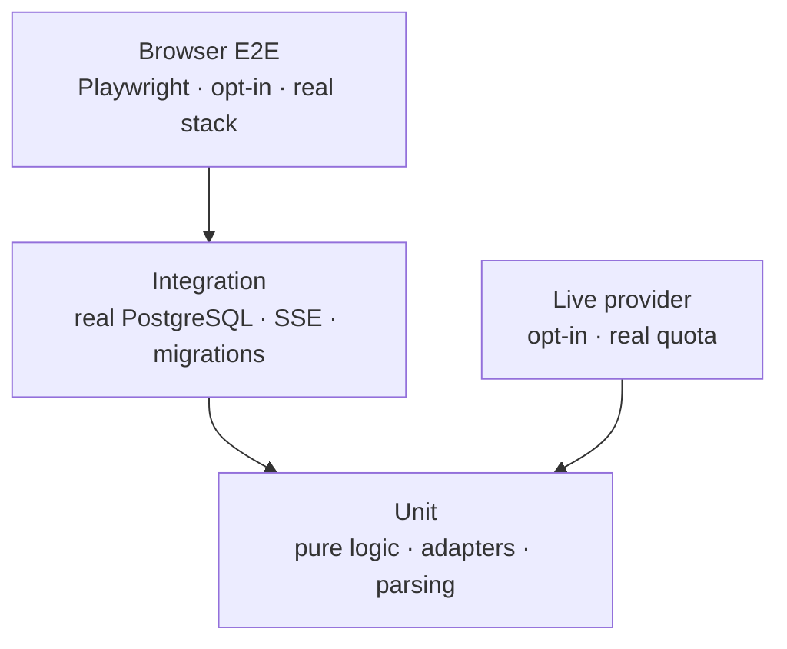

# Testing

The point of the test suite is not the coverage number. It is that the parts of an LLM application that usually go untested — the shape of a stream, what happens after a stop, what a retry does to history, what a failed provider call leaves behind — are tested here, offline, in about thirty seconds.

## The shape of the suite



| Layer | Count | Runs by default | What it needs |
| --- | --- | --- | --- |
| Backend unit | 18 files | yes | nothing |
| Backend integration | 13 files | yes, skipped if no database | PostgreSQL |
| Frontend | 26 files / 125 tests | yes | jsdom |
| Backend total | **258 passed, 1 skipped** | yes | ~30 s |
| Browser E2E | 3 scenarios | no | a running stack |
| Live provider | 1 file | no | a real key, `LUCID_LIVE_TESTS=1` |

## Unit tests — logic without a network

| Area | File | Proves |
| --- | --- | --- |
| Context selection | `test_context.py` | the budget is respected, the newest message is always kept, an impossible request fails instead of truncating |
| Retry policy | `test_retry.py` | only eligible errors retry, backoff stays bounded, no retry after the first token |
| Error mapping | `test_gemini_mapping.py`, `test_openai_compatible.py` | provider failures become domain errors with the right `retryable` flag |
| Adapter transport | `test_gemini_transport.py`, `test_openai_compatible.py` | SSE parsing across chunk splits, CRLF, malformed frames, usage-only chunks, `[DONE]` |
| Cancellation cooldown | `test_cooldown.py` | a 429 starts a wait and the next call fails fast with the remaining time |
| Catalogue and registry | `test_provider_factory.py` | only configured providers are offered, the default is stable, one client per provider |
| Dashboard math | `test_dashboard_buckets.py`, `test_dashboard_pricing.py`, `test_dashboard_service.py` | UTC buckets, percentile handling, cost only when pricing exists |
| Titles, cursors, ids | `test_titles.py`, `test_cursor.py`, `test_ids.py` | 80-code-point titles, opaque cursors, UUIDv7 ordering |
| Quality gates | `test_code_health.py`, `test_import_boundary.py` | budgets hold; the domain layer never imports adapters |

The database is never mocked in integration tests. The provider is.

## Integration tests — the real database, the real stream

These run against PostgreSQL, apply the migrations, and **truncate the chat tables between cases**. They skip automatically when no database is reachable, so a checkout without Docker still runs the unit suite.

| File | Proves |
| --- | --- |
| `test_chat_stream.py` | the full SSE frame sequence, stop, disconnect, and the untracked-stop path after a restart |
| `test_streaming_service.py` | terminal persistence, usage storage, partial text on interruption |
| `test_retry_behaviour.py` | retry reuses the user message, increments `attempt_no`, refuses after a completed attempt |
| `test_conversations_api.py` | list/get/delete, keyset pagination, cursor validation |
| `test_models_api.py` | the catalogue endpoint, and `400 model_not_available` before anything is written |
| `test_schema.py`, `test_migrations.py` | constraints, the partial unique index, migration up/down |
| `test_reconciliation.py` | startup closes attempts stranded by a crash |
| `test_dashboard_api.py`, `test_dashboard_queries.py` | aggregation against seeded attempts, range boundaries |
| `test_retention.py` | old attempts are deleted, conversations are not |

One property is worth calling out: **the tests never sleep to wait for a stream.** The fake provider emits on demand, so timing assertions are about ordering, not wall-clock luck. The only timing-sensitive test is the live one, which is opt-in.

## Frontend tests — the states a user can see

Vitest + React Testing Library, with `fetch` stubbed by replaying recorded SSE frames.

- **Streaming and cancellation** — `useChatStream.test.tsx`, `stream-events.test.ts`, `Composer.test.tsx`, `App.test.tsx`.
- **The model picker** — `ModelPicker.test.tsx` (keyboard, escape, outside click, disabled state) and `App.models.test.tsx` (a failed catalogue fetch retries instead of hiding the picker).
- **Rendering** — `Markdown.test.tsx` sanitization cases (`<script>`, `javascript:`, `<iframe>`, `onerror`), `MessageList.test.tsx`, `ConfirmDialog.test.tsx`.
- **Dashboard** — one test file per chart plus `DashboardPage.test.tsx` for loading, empty, error and partial-data states.

Two deliberate gaps:

1. **jsdom is not a browser.** It keeps focus on a disabled element, while browsers blur it. The composer-focus test therefore blurs the textarea explicitly to reproduce the browser, and the StrictMode regression is tested by rendering the app inside `<StrictMode>`.
2. **No snapshot tests.** Charts are asserted through labels and computed data, not pixels.

## Browser E2E

`frontend/e2e/chat.spec.ts` drives the assembled app: send a message and see the reply, reload and reopen it, delete it through the dialog. It is deliberately not in CI — it needs a Compose stack and a browser download.

```powershell
docker compose -f docker-compose.yml -f docker-compose.e2e.yml --profile full up -d --build
cd frontend
npm run e2e
```

Start the stack with the scripted provider for a deterministic run; point `E2E_BASE_URL` elsewhere to test another deployment.

## Live provider tests

`tests/live/test_provider_latency.py` is the only test that touches a real provider, because the fake cannot reproduce a 25-second first token. It is opt-in:

```powershell
$env:LUCID_LIVE_TESTS = "1"
uv run pytest tests/live
```

It records first-token latency and a full stream, which is how the model choice was measured rather than guessed.

## The commands

```powershell
# Backend, from backend/
uv run pytest -q                                   # 258 passed, 1 skipped
uv run pytest -q --cov=lucid --cov-branch --cov-fail-under=80
uv run pytest tests/unit
uv run pytest tests/integration

# Frontend, from frontend/
npm test
npm run test:coverage                              # thresholds: 75% lines/statements, 70% branches/functions
npm run e2e
```

CI runs the backend suite against a PostgreSQL service container, with migrations applied first, and fails below **80 % coverage** — the current figure is **89.6 %**.
